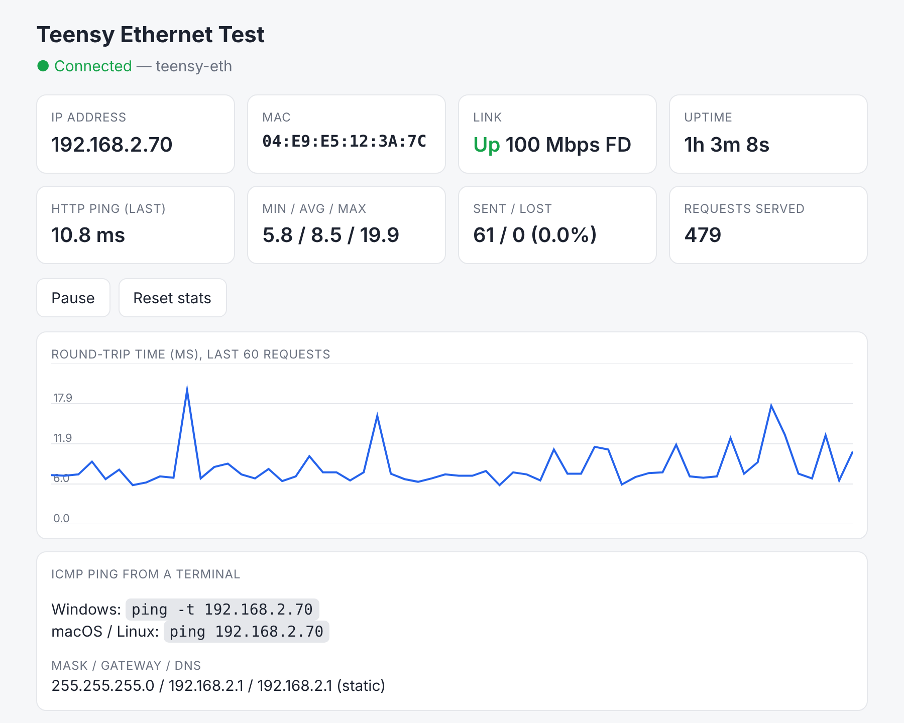

# Teensy Ethernet Adapter Test

Test firmware for the Teensy 4.1 Ethernet adapter. The Teensy runs on a static IP
(**192.168.2.70**) and serves a live dashboard you can ping.



## Quick start

1. Install the **QNEthernet** library, then upload `TeensyEthernetTest/TeensyEthernetTest.ino` to a Teensy 4.1.
2. Plug the adapter straight into your PC and set the PC's Ethernet port to a static IP (run in an Admin PowerShell):
   ```powershell
   netsh interface ip set address name="Ethernet" static 192.168.2.1 255.255.255.0
   ```
3. Run `ping -t 192.168.2.70`, or open **http://192.168.2.70/** in a browser.
